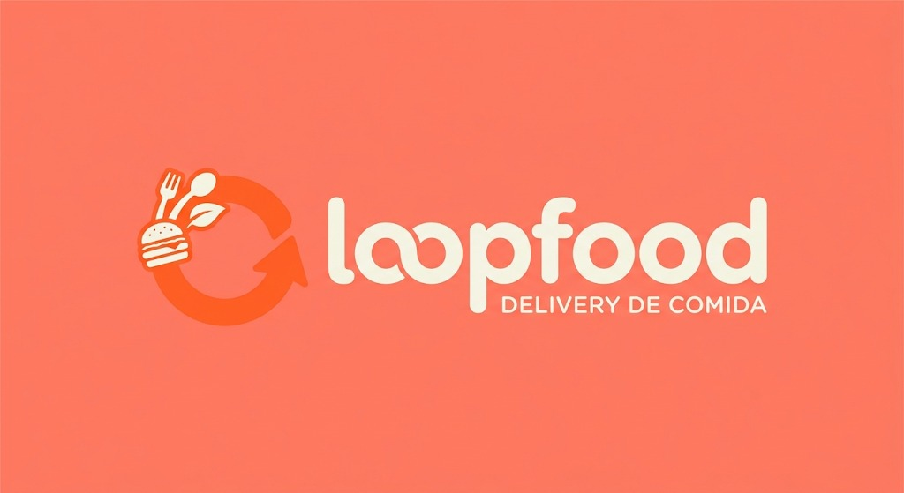

<div align="center">
  

  # 🍔 FoodLoop - Delivery & Cardápio Digital

  *A sua fome no loop certo: rápido, prático e delicioso.*
  
  
  
  
  

</div>

---

## 📖 Índice

- [Sobre o Projeto](#-sobre-o-projeto)
- [Funcionalidades Principais](#-funcionalidades-principais)
- [Estrutura do Projeto](#-estrutura-do-projeto)
- [Tecnologias Utilizadas](#-tecnologias-utilizadas)
- [Documentação e Requisitos](#-documentação-e-requisitos)
- [Como Executar](#-como-executar)
- [Próximos Passos](#-próximos-passos)
- [Autores](#-autores)

---

## 🍕 Sobre o Projeto

O **FoodLoop** é uma aplicação web voltada para o setor de *food service* (restaurantes e lanchonetes). O projeto consiste em uma interface *Front-end* completa que simula a experiência de um usuário desde o momento em que ele acessa o cardápio digital até a finalização do seu pedido.

O foco principal do desenvolvimento foi criar uma interface amigável (UI), com uma experiência de usuário (UX) fluida, garantindo que a navegação entre as categorias de produtos, gerenciamento de carrinho e acompanhamento de pedidos seja o mais intuitiva possível.

---

## ✨ Funcionalidades Principais

A jornada do usuário foi mapeada e implementada através de diversas telas interativas:

*   🔐 **Autenticação:** Telas dedicadas para `Login` e `Registro` de novos usuários.
*   🏠 **Página Inicial (Home):** Vitrine com destaques do dia, banners e atalhos rápidos.
*   🍔 **Exploração de Cardápio:** 
    *   Página de `Produtos` com listagem completa.
    *   Página de `Categorias` para filtrar por lanches, pizzas, comida oriental, bebidas, opções fit e sobremesas.
*   🛒 **Gestão de Compras:** 
    *   `Carrinho` de compras dinâmico para revisar itens antes do checkout.
    *   Acompanhamento de `Pedidos` em andamento e histórico.
*   ❤️ **Favoritos:** Área exclusiva para o cliente salvar os pratos que mais ama.
*   📞 **Institucional:** Páginas `Sobre` a empresa e formulário de `Contato`.

---

## 📂 Estrutura do Projeto

O repositório está organizado de forma semântica e modular:

```text
📦 foodloop
 ┣ 📂 apresentacao-e-sobre     # Documentação oficial do projeto (Requisitos e Slides)
 ┣ 📂 img                      # Assets fotográficos dos pratos (burguer, sushi, pizzas, etc.)
 ┣ 📂 logo                     # Identidade visual do projeto
 ┣ 📜 index.html / home.html   # Ponto de entrada da aplicação
 ┣ 📜 categorias.html          # Filtro de pratos
 ┣ 📜 produtos.html            # Listagem de pratos
 ┣ 📜 carrinho.html            # Checkout
 ┣ 📜 pedidos.html             # Histórico
 ┣ 📜 favoritos.html           # Pratos curtidos
 ┣ 📜 login.html & registro.html # Telas de acesso
 ┣ 📜 sobre.html & contato.html  # Informações institucionais
 ┣ 📜 style.css                # Folha de estilos unificada
 ┗ 📜 app.js                   # Lógica de interatividade e manipulação do DOM
```

---

## 💻 Tecnologias Utilizadas

Este projeto foi construído utilizando as principais tecnologias base do desenvolvimento web:

*   **HTML5:** Estruturação semântica visando acessibilidade e SEO.
*   **CSS3:** Estilização global com CSS puro (`style.css`), utilizando Flexbox/Grid para layouts responsivos.
*   **JavaScript (Vanilla JS):** Arquivo `app.js` responsável pela manipulação do DOM, controle de estado do carrinho e interações do usuário.

---

## 📚 Documentação e Requisitos

Este projeto possui uma base sólida de engenharia de requisitos e planejamento. Na pasta `/apresentacao-e-sobre`, você encontra:

*   📄 **`Relatorio_e_Requisitos_FoodLoop.docx`**: Documento detalhado contendo a definição do escopo, regras de negócio, e levantamento de requisitos funcionais e não-funcionais.
*   📊 **`Apresentacao_FoodLoop.pptx.pdf`**: Material de apresentação executiva do projeto, ideal para entender a visão do produto.

---

## 🚀 Como Executar

Por ser uma aplicação Front-end nativa (sem frameworks pesados), rodar o projeto é extremamente simples:

1. **Clone o repositório** para a sua máquina local:
   ```bash
   git clone https://github.com/SEU_USUARIO/foodloop.git
   ```

2. **Acesse o diretório** do projeto:
   ```bash
   cd foodloop
   ```

3. **Inicie a aplicação**:
   Basta dar um duplo clique no arquivo `home.html` para abri-lo no seu navegador padrão. 
   > 💡 *Recomendação: Para uma experiência de desenvolvimento melhor, utilize a extensão **Live Server** no Visual Studio Code.*

---

## 🔮 Próximos Passos (Futuro)

Ideias para evolução do projeto:
- [ ] Integração com Back-end (Node.js/Express ou Python/Django).
- [ ] Modelagem de banco de dados (MySQL ou MongoDB) para salvar usuários e histórico real de pedidos.
- [ ] Implementação de API de pagamentos (Ex: Mercado Pago, Stripe).
- [ ] Consumo de API de CEP para cálculo de frete.

---

## 👨‍💻 Autores

Desenvolvido com dedicação por:

*   **[Seu Nome/Nome da Equipe]** 
    *   GitHub: [@Rafael-Santos-Tech](https://github.com/Rafael-Santos-Tech) 
    *   GitHub: [@Cauaandrade2000](https://github.com/auaandrade2000)
     
    *   LinkedIn: [@Rafael dos Santos](https://linkedin.com/in/rafael-dos-santos-ferreira-lima-4996a942b)
    *   LinkedIn: [@Cauã Andrade](https://linkedin.com/in/cauã-andrade-54b35334b)

---
<p align="center">Feito com ❤️ para saciar a sua fome de código!</p>